# GHAS

[Download the PowerPoint presentation](presentations/GHAS.pptx)

## Slide 1

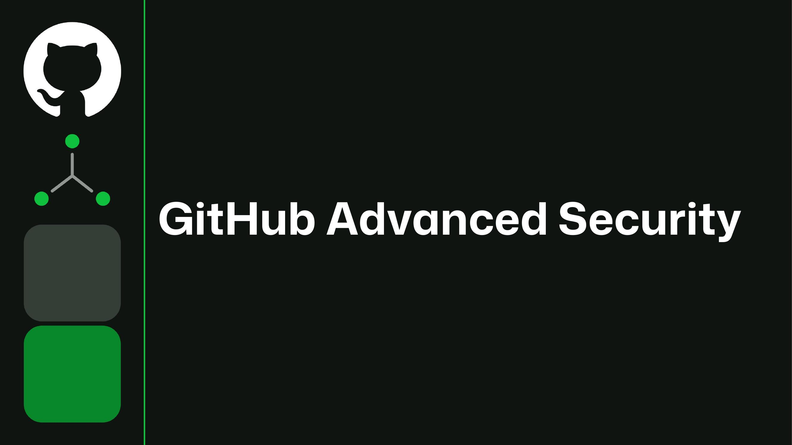

## Slide 2

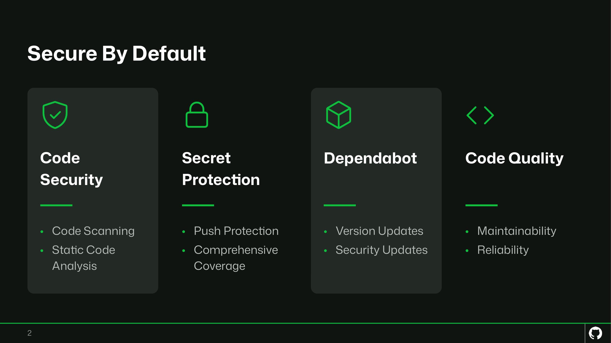

## Slide 3

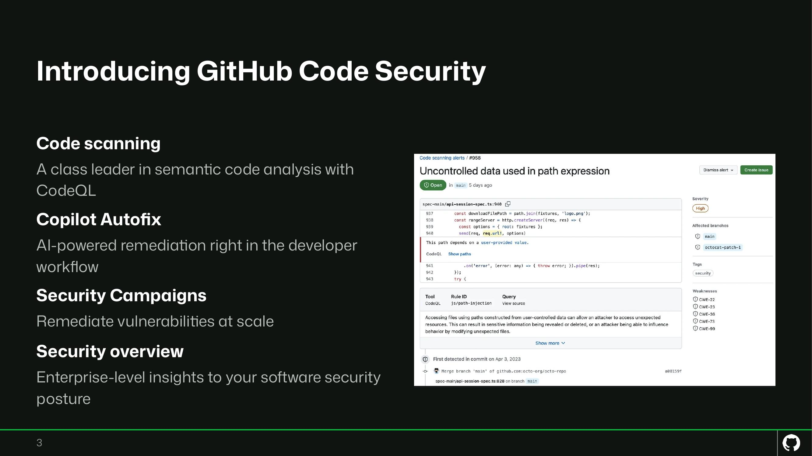

## Slide 4

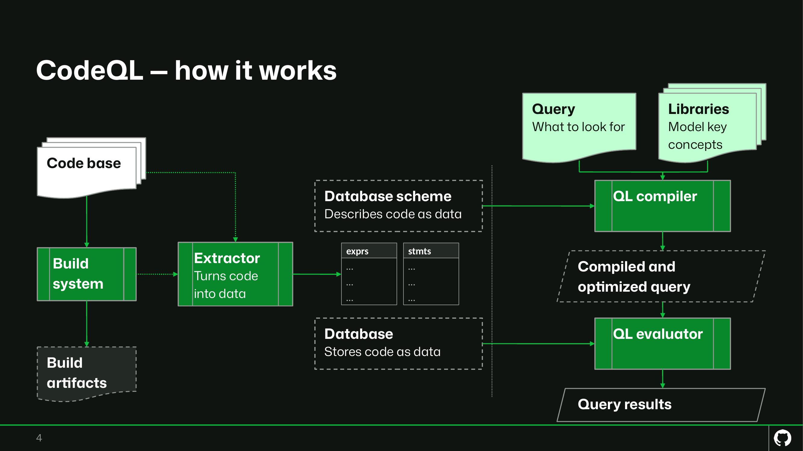

## Slide 5

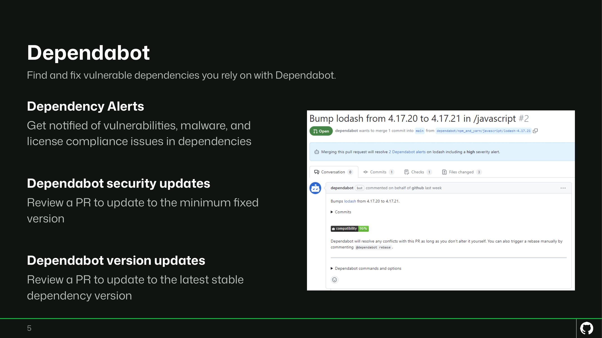

## Slide 6

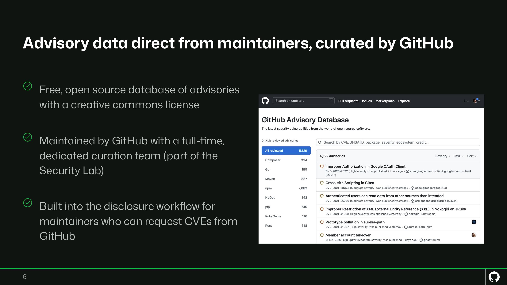

## Slide 7

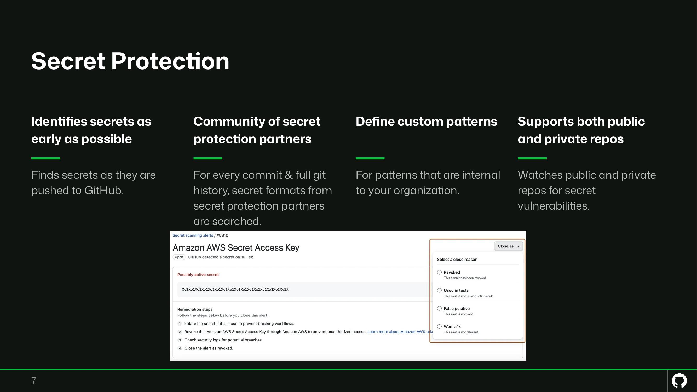

## Slide 8

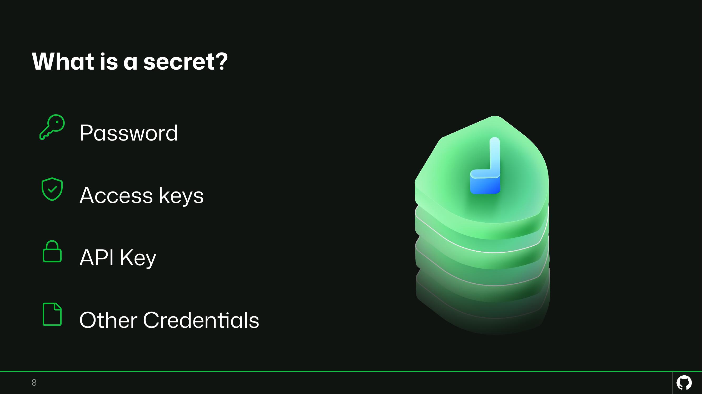

## Slide 9

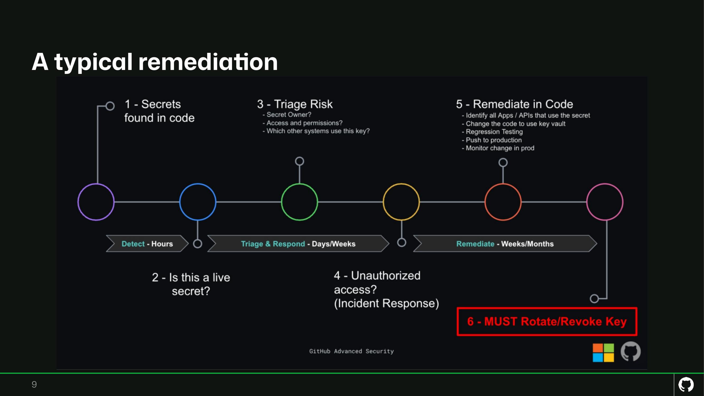

## Slide 10

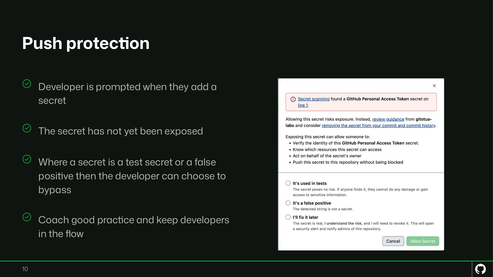

## Slide 11

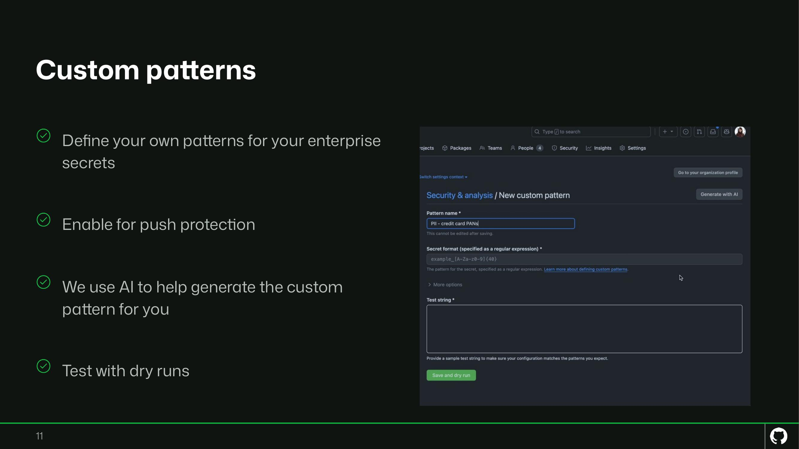

## Slide 12

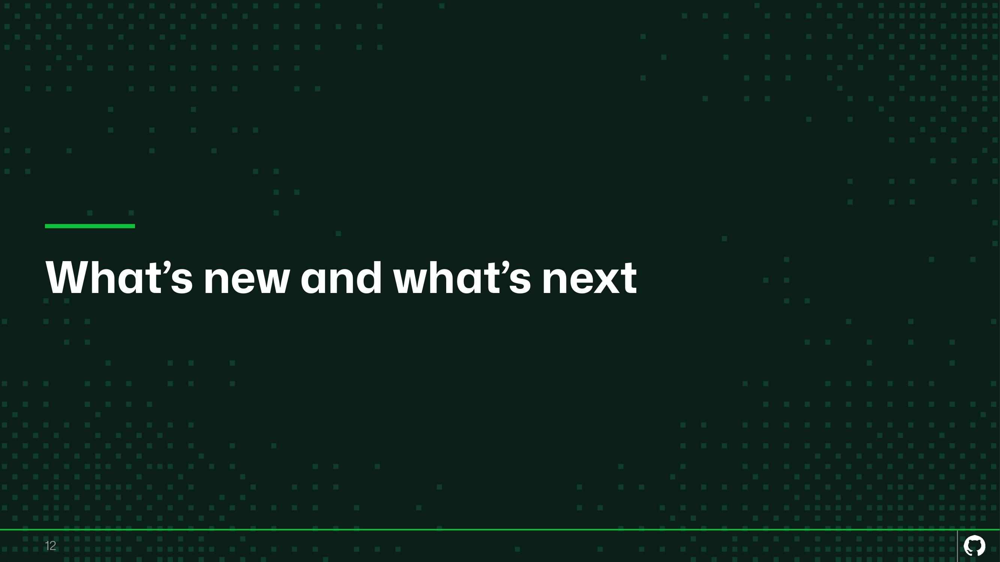

## Slide 13

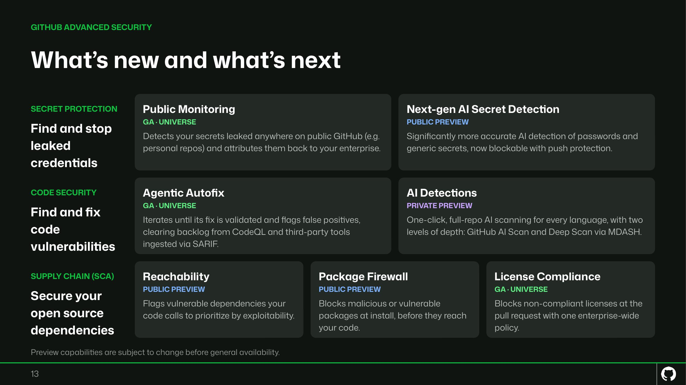

## Slide 14

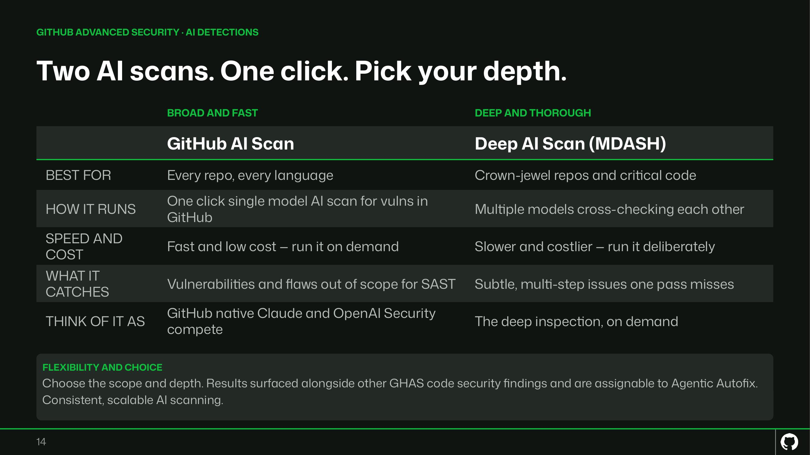

## Slide 15

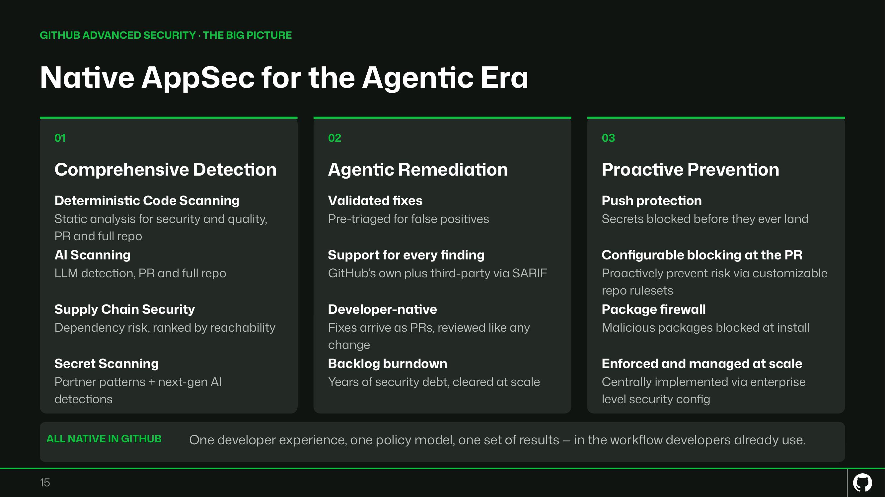
